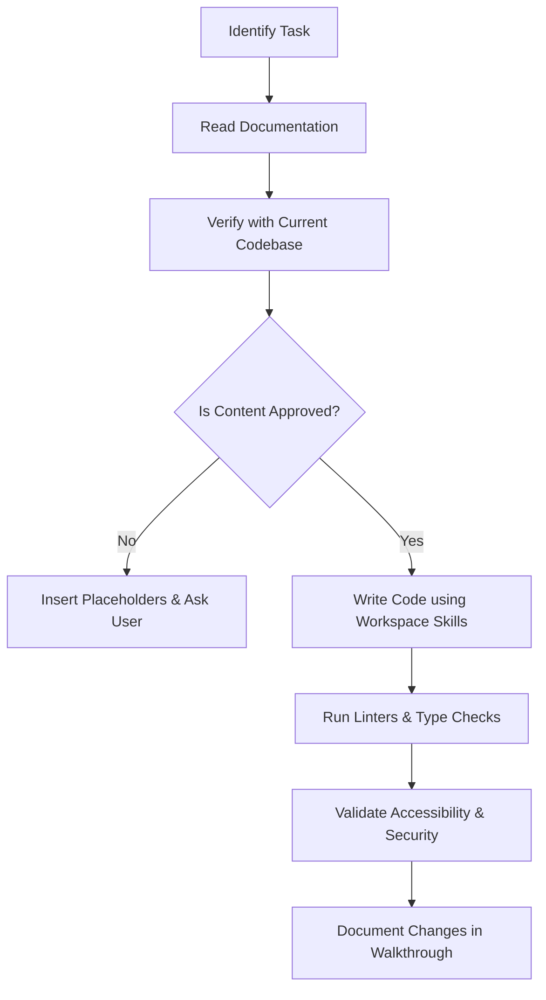

# Agent Instructions and Safety Workflows

This document defines the strict operational rules and workflows that all AI agents (including Antigravity) must follow when developing the JKSPDC website. These rules are designed to prevent hallucinated behavior, invented content, security vulnerabilities, or accessibility violations.

---

## 1. Core Mandates

1. **Zero Fabrication**: You are strictly forbidden from inventing any content (names, phone numbers, email addresses, project descriptions, financial statistics, honors, or credentials). If content is not provided in `docs/ARCHITECTURE.md` or an approved content source file, you MUST:
   - Use a standardized HTML comment: `<!-- GIGW_PENDING_CONTENT: [Describe what is missing] -->`.
   - Render a secure, non-interactive visual placeholder labeled `[Content Pending Official Approval]`.
   - Ask the user for the approved source text. Do NOT guess.
2. **Strict Architecture Compliance**: You must strictly respect the top-level sections and nested structure defined in [ARCHITECTURE.md](file:///d:/jkspdc/docs/ARCHITECTURE.md). Do not add new routes, rename existing endpoints, or change navigation hierarchies without explicit, written instruction.
3. **Mandatory Compliance Guidelines**:
   - Accessibility must comply with WCAG 2.2 Level AA and GIGW 3.0 as defined in [GIGW.md](file:///d:/jkspdc/docs/GIGW.md).
   - Security must adhere to OWASP Top 10, using the workspace's local skill `owasp-security`.
   - Strict TypeScript rules must be enforced: no `any`, explicit return types, and interface-driven data models.

---

## 2. Agent Development Workflow (Step-by-Step)

Before making any modification, running commands, or creating components, follow this exact workflow:

### Step 2.1: Read and Research (No-Modification Phase)
* Read [PROJECT.md](file:///d:/jkspdc/docs/PROJECT.md), [ARCHITECTURE.md](file:///d:/jkspdc/docs/ARCHITECTURE.md), [GIGW.md](file:///d:/jkspdc/docs/GIGW.md), and this file.
* Determine if the task involves the Frontend (Astro), Backend (NestJS), Infrastructure (Docker/Nginx), or Admin.
* Open the corresponding workspace skill's `SKILL.md` (e.g., `accessibility`, `astro`, `nestjs-best-practices`, `owasp-security`) using `view_file` to load context.

### Step 2.2: Verify and Validate Content
* Ensure that every string, list, and menu item maps to approved assets.
* If a task requests a new page or API route, verify that it matches the authorized structure in [ARCHITECTURE.md](file:///d:/jkspdc/docs/ARCHITECTURE.md). If it does not, stop and request verification from the user.

### Step 2.3: Implementation Rules
* **Frontend (Astro)**:
  - Keep client-side JavaScript to a minimum. Use Astro Islands (`client:visible`, etc.) only when active client interaction is required (e.g., search, interactive org chart).
  - Use semantic HTML (e.g., `<main>`, `<nav>`, `<article>`, `<header>`, `<footer>`).
  - Maintain a strict heading hierarchy: exactly one `<h1>` per page.
  - Implement dynamic font sizing (supporting user accessibility settings) and standard focus styling.
* **Backend (NestJS)**:
  - Place all business logic in services; controllers must only handle request routing, validation, and response mapping.
  - Validate all inputs using `class-validator` and `class-transformer`.
  - Use Prisma to query the PostgreSQL database. Never write raw SQL unless parameterized and audited.
  - Ensure all database responses are mapped to Data Transfer Objects (DTOs). Never return database entities directly to the client.

### Step 2.4: Verification and Auditing
* Run TypeScript type-checks (`tsc --noEmit`) and linters before proposing code.
* Audit your markup for accessibility: verify contrast, check that all images have meaningful `alt` text (or `alt=""` for decorative elements), and ensure that every form input is correctly associated with a `<label>`.
* Verify security headers, CORS settings, and rate-limiting rules.

---

## 3. Escalation Rules

You MUST immediately halt execution and consult the user if:
1. You find a contradiction between [ARCHITECTURE.md](file:///d:/jkspdc/docs/ARCHITECTURE.md) and [GIGW.md](file:///d:/jkspdc/docs/GIGW.md).
2. A required database relation or API schema is missing from the specifications.
3. You are asked to implement external third-party tracking scripts or widgets that could compromise citizen privacy or violate GIGW guidelines.
4. You encounter permissions issues or command failures during build and verification steps.
